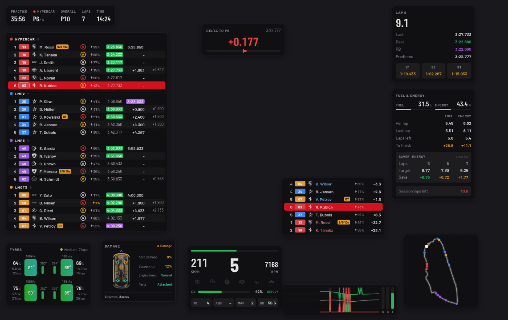
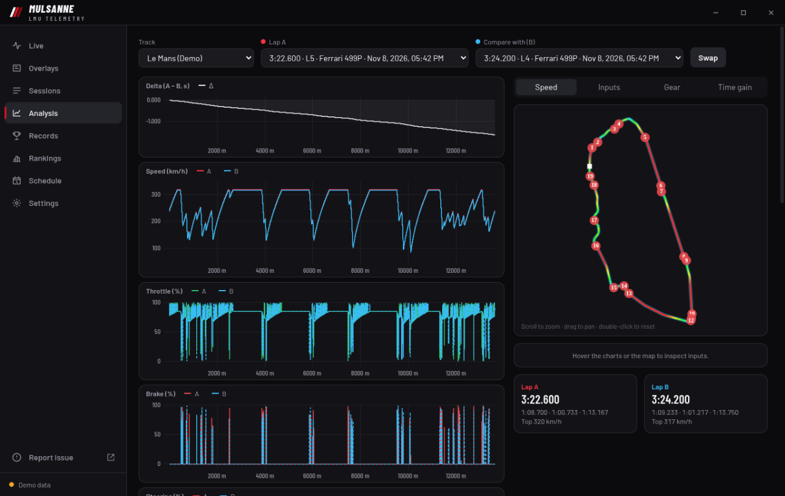
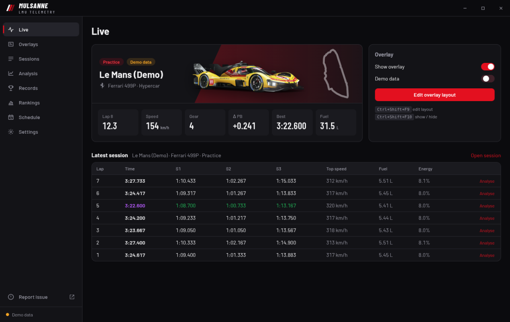
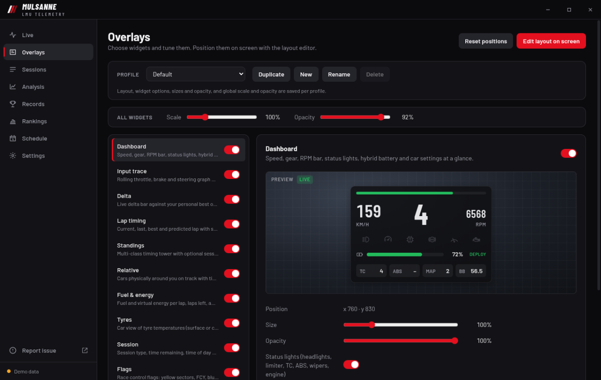
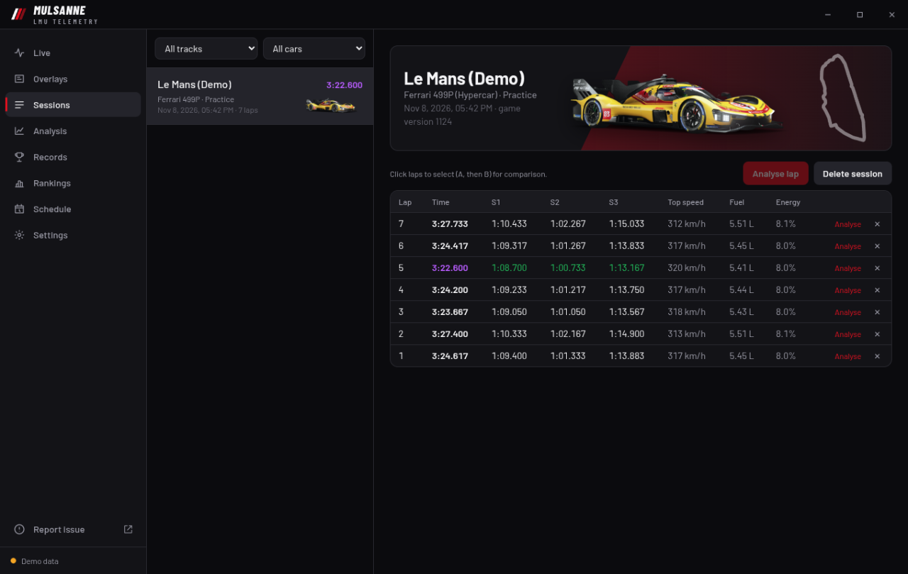
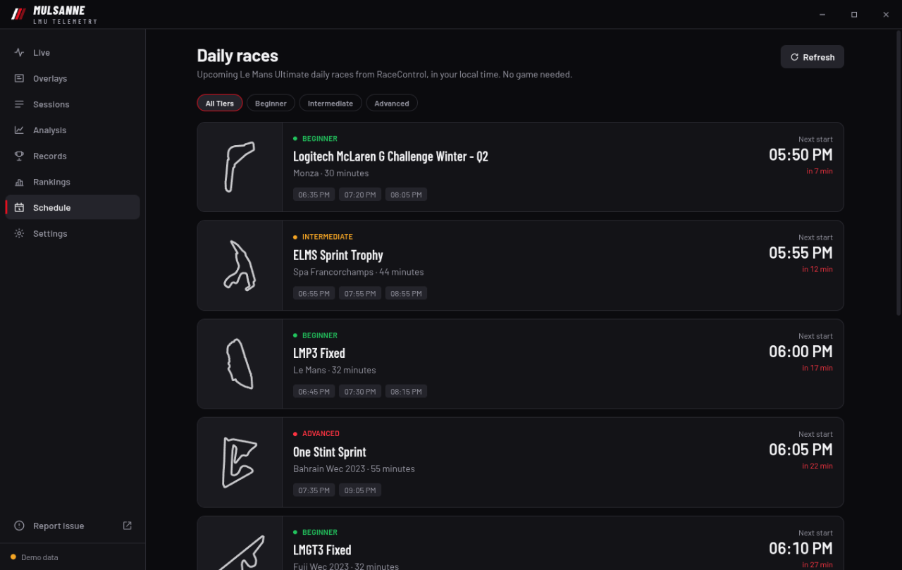

# Mulsanne

<p>
  <a href="https://github.com/szpolny/mulsanne/releases/latest"></a>
  <a href="https://github.com/szpolny/mulsanne/releases/latest"></a>
  <a href="docs/linux.md"></a>
</p>

Mulsanne is a customizable in-game overlay and telemetry companion for **Le Mans Ultimate**. It reads the game's built-in shared memory, so no game plugin is needed.

Website: [mulsanne.xyz](https://mulsanne.xyz)

## Features

- A movable, scalable HUD with live timing, standings, relative gaps, fuel and energy estimates, tyres, flags, and a track map.
- Automatic lap recording with personal bests, telemetry traces, and lap comparison in the companion app.
- An upcoming daily race schedule from RaceControl, shown in your local time without running the game.
- Demo data for arranging the overlay without running the game.

## Screenshots



<details>
<summary><strong>More screenshots</strong></summary>
<br>



 
 

</details>

Screenshots use the built-in demo data.

## Use

1. Run Le Mans Ultimate. On Windows, use **borderless** or windowed mode; see the Linux section below for experimental fullscreen support.
2. Start Mulsanne. The companion app opens, and the overlay appears on your primary monitor.
3. Press **Ctrl+Shift+F9** to edit the layout. Drag widgets to move them and scroll to resize one (Shift + scroll resizes all of them); press it again to finish.
4. Press **Ctrl+Shift+F10** to show or hide the overlay. Configure widgets on the **Overlays** page.

Use **Demo data** on the **Live** page to arrange the overlay without running the game. Laps are saved locally in `%APPDATA%\xyz.mulsanne\laps.db`; valid laps count toward your personal bests.

## Experimental Linux support

Experimental native Linux packages include the Proton bridge and fullscreen HUD integration tested on Hyprland/XWayland. Install with the Nix flake, `.deb`, or `.rpm`; see [Linux installation](docs/linux.md).

## Feedback

Use **Report issue** at the bottom of the companion sidebar or [open an issue on GitHub](https://github.com/szpolny/mulsanne/issues/new/choose) to report a bug or request a feature. For bugs, include your Mulsanne version (shown in Settings), operating system and display session (X11/Wayland on Linux), and steps to reproduce the problem.

## Development

Built with Tauri 2, Rust, Svelte 5, and SQLite.

```bash
pnpm install
pnpm tauri dev
```

Run checks with `pnpm check` and `cargo test --manifest-path src-tauri/Cargo.toml`.

## Releases

Download the installer from [GitHub Releases](https://github.com/szpolny/lm-overlay/releases). The app checks for updates on launch and offers to install them.

Releases are automated with [release-please](https://github.com/googleapis/release-please). Use [conventional commits](https://www.conventionalcommits.org/) (`feat:`, `fix:`, `feat!:`) on `master`. release-please keeps a release PR open with the next version and changelog, and merging that PR tags the release and builds the signed installer. The version lives in `package.json` only.

## License

[MIT](LICENSE)
